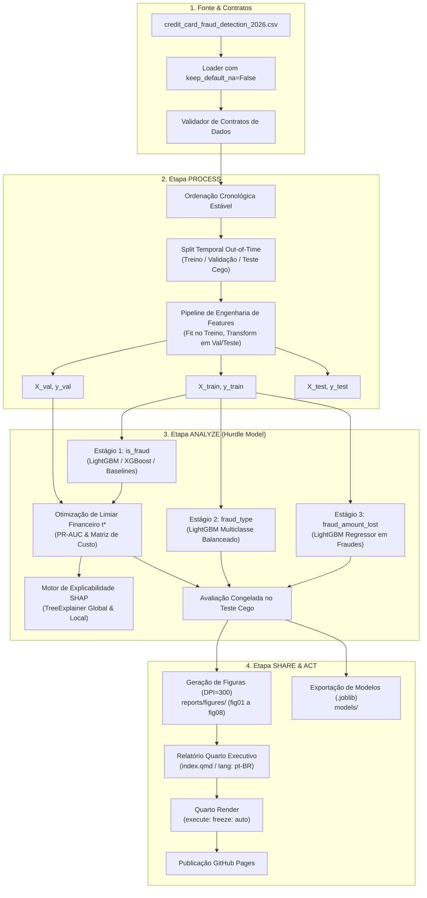

# Arquitetura do Pipeline Analítico e Especificação Técnica (Gate 3)

- **Projeto:** Detecção, Tipificação e Quantificação de Fraudes em Cartão de Crédito
- **Arquétipo:** A — Data Science, Analytics & Machine Learning
- **Artefato:** `docs/03-architecture-and-schema.md`
- **Status:** Proposta de Arquitetura para Validação

---

## 1. Topologia Geral do Pipeline (Process ➔ Analyze ➔ Share ➔ Act)

O sistema foi estruturado em quatro macro-etapas sequenciais.
Cada etapa possui limites de responsabilidade claros e interfaces desacopladas.



---

## 2. Desenho Detalhado da Etapa PROCESS (Saneamento & Engenharia de Atributos)

### 2.1 Ingestão e Saneamento
1. **Carregamento Seguro:** `src/data/loader.py` consome o CSV com `keep_default_na=False`, assegurando que as 41.709 ocorrências de `'N/A'` em `browser` sejam lidas como a categoria válida `N/A` (ADR 0004).
2. **Correção Cronológica:** Aplicação de `df.sort_values(by='transaction_datetime', ascending=True)` para corrigir a inversão pontual de 28/02/2026.
3. **Poda de Identificadores:** Descarte imediato de `transaction_id` (chave sequencial) e `card_id` (100% redundante com `customer_id`).
4. **Isolamento de Targets:** Separação das matrizes de features $X$ e do vetor/tupla de alvos $Y = (\text{is\_fraud}, \text{fraud\_type}, \text{fraud\_amount\_lost})$ antes de qualquer transformação.

### 2.2 Particionamento Temporal Out-of-Time
A divisão dos conjuntos é realizada cronologicamente por máscara temporal estrita (ADR 0002):
- **Treino:** `transaction_datetime < '2026-09-01'` (66.860 linhas, 1.378 fraudes).
- **Validação:** `'2026-09-01' <= transaction_datetime < '2026-11-01'` (16.905 linhas, 362 fraudes).
- **Teste Cego:** `transaction_datetime >= '2026-11-01'` (16.235 linhas, 315 fraudes).

### 2.3 Receitas de Engenharia de Features (`src/features/pipeline.py`)

Todas as transformações que dependem de parâmetros estatísticos da amostra são ajustadas (*fit*) exclusivamente sobre os dados de **Treino**:

1. **Features Temporais e Cíclicas:**
   - Decomposição periódica da hora do dia para manter continuidade entre 23h e 00h:
     $$\text{hour\_sin} = \sin\left(\frac{2\pi \cdot \text{hour}}{24}\right), \quad \text{hour\_cos} = \cos\left(\frac{2\pi \cdot \text{hour}}{24}\right)$$
   - Flag indicadora de janela noturna crítica: `is_night_window = transaction_hour in [1, 2, 3, 4]`.
2. **Dinâmica Espacial e Velocidade de Deslocamento:**
   - Velocidade aparente entre transações consecutivas ($V_{aparente}$):
     $$V_{aparente} = \frac{\text{distance\_from\_last\_tx\_km}}{\text{days\_since\_last\_transaction} \cdot 24 + 0,1} \quad [\text{km/h}]$$
     Saltos superiores a 500 km/h indicam impossibilidade física de deslocamento, sinal clássico de clonagem física ou comprometimento de credencial.
   - Flag de transação em país de alto risco (`is_high_risk_country`).
3. **Anomalia de Ticket e Comportamento de Gastos:**
   - Z-score transacional individual relativo ao histórico de 30 dias:
     $$Z_{\text{amount}} = \frac{\text{transaction\_amount} - \text{avg\_transaction\_amount\_30d}}{\text{std\_transaction\_amount\_30d} + 1,0}$$
   - Flag de salto de valor extremo: `is_spike_amount = amount_vs_avg_ratio >= 5.0`.
   - Utilização do limite de crédito: $\text{limit\_utilization} = \frac{\text{transaction\_amount}}{\text{credit\_limit}}$.
4. **Agregações de Velocidade Recente:**
   - Intensidade média monetária por evento na última hora:
     $$\text{amount\_per\_tx\_1h} = \frac{\text{amount\_last\_1h}}{\text{transactions\_last\_1h} + 1}$$
   - Razão de aceleração de curto prazo vs. semanal: $\frac{\text{transactions\_last\_24h} \cdot 7}{\text{transactions\_last\_7d} + 1}$.
5. **Codificação de Variáveis Categóricas:**
   - **One-Hot Encoding:** Para categorias de baixa cardinalidade (`customer_gender`, `transaction_channel`, `device_type`, `browser`, `email_domain`).
   - **Target Encoding Regularizado com Suavização de Bayes:** Para atributos de média/alta cardinalidade (`merchant_category`, `merchant_country`, `customer_state`), calculado com pesos restritos ao treino e suavização $m=10$ para prevenir vazamento e overfitting em categorias raras.

---

## 3. Desenho Detalhado da Etapa ANALYZE (Modelagem e Explicabilidade)

A estratégia analítica implementa a arquitetura em três estágios (*Hurdle Model*, ADR 0001) empregando algoritmos de gradient boosting (ADR 0003).

### 3.1 Estágio 1: Detecção Binária (`is_fraud`)
- **Objetivo:** Prever a probabilidade $p_i = P(\text{is\_fraud}_i = 1 \mid X_i)$.
- **Baselines de Comparação:**
  1. *Dummy Classifier:* Estimador estratificado pela frequência histórica (prevalência 2,05%).
  2. *Regressão Logística Regularizada:* Com pesos inversos à frequência de classe (`class_weight='balanced'`).
  3. *Balanced Random Forest:* Floresta com subamostragem balanceada nas folhas.
- **Modelos Principais Candidatos:**
  1. *LightGBM Classifier:* Otimizado com `scale_pos_weight = (97945 / 2055) \approx 47.6` e função de perda binária logloss.
  2. *XGBoost Classifier:* Configurado com `scale_pos_weight` e subamostragem de colunas (`colsample_bytree`).
- **Protocolo de Calibração e Limiar Ótimo ($t^*$):**
  - No conjunto de **Validação**, varre-se o threshold $t \in [0.01, 0.99]$ calculando o custo total:
    $$C(t) = \sum_{i \in FN(t)} \text{PerdaReal}_i + \sum_{i \in FP(t)} \$3,50$$
  - O corte ótimo $t^*$ é selecionado como o ponto mínimo da curva $C(t)$ e congelado para aplicação no conjunto de Teste Cego (ADR 0005).
- **Métricas:** PR-AUC (primária), F1 ótimo, ROC-AUC, Precisão, Recall e Economia Líquida (\$).

### 3.2 Estágio 2: Tipificação da Fraude (`fraud_type`)
- **Objetivo:** Classificar a transação fraudulenta entre as 4 modalidades ativas:
  - `Card-Not-Present` (51,3% das fraudes)
  - `Account-Takeover` (21,8% das fraudes)
  - `Synthetic-Identity` (15,0% das fraudes)
  - `Card-Present` (11,9% das fraudes)
- **Modelagem:**
  - *LightGBM Multiclass:* Com objetivo `multiclass`, 4 classes de saída e pesos balanceados calculados pelo inverso da prevalência de cada subtipo no treino.
  - Features de maior relevância esperada: canal digital, browser, uso de chip/PIN, salto geográfico (`distance_from_last_tx_km`) e idade da conta (`account_age_days`).
- **Métricas:** Macro F1-Score (primária), Balanced Accuracy e Matriz de Confusão com percentuais por linha.

### 3.3 Estágio 3: Quantificação da Perda Residual (`fraud_amount_lost`)
- **Objetivo:** Para transações confirmadas como fraude, estimar o prejuízo em dólares pós-recuperação parcial.
- **Modelagem Condicional:**
  - Treinado estritamente sobre as instâncias de Treino onde $\text{is\_fraud} == 1$ ($N \approx 1.378$ transações).
  - Algoritmo: *LightGBM Regressor* com função de perda Huber (resistente a outliers na cauda longa) comparado a *Ridge Regression* como baseline.
- **Métricas:** RMSE (primária), MAE e $R^2$ condicional sobre as fraudes do Teste Cego.

### 3.4 Motor de Explicabilidade SHAP
- Para o modelo campeão do Estágio 1, instancia-se o `shap.TreeExplainer`.
- **Análise Global:** Cálculo dos valores médios absolutos de SHAP ($\frac{1}{N}\sum |\phi_j|$) para ordenar as 15 variáveis mais determinantes para o risco de fraude.
- **Análise Local:** Geração de *Waterfall Plots* para transações de teste contrastantes:
  1. *Verdadeiro Positivo Crítico:* Transação noturna em país de risco com disparo de velocidade bloqueada com sucesso.
  2. *Falso Positivo Notável:* Transação legítima que acionou alerta de atrito (para auditoria de regras de negócio).

---

## 4. Desenho Detalhado da Etapa SHARE (Storyboard e Padrões Quarto)

Conforme o [quarto-quality-checklist.md](file:///home/tales/.gemini/config/skills/pre-code-pipeline/references/quarto-quality-checklist.md), o relatório será estruturado em Quarto (`index.qmd`) com metadados em português (`lang: pt-BR`), `execute: freeze: auto` e figuras padronizadas.

### 4.1 Especificação do Storyboard Visual (8 Figuras)

```
Painel de Figuras do Relatório:
┌───────────────────────────────┐ ┌───────────────────────────────┐
│ fig01: Horário x Fraude (P1)  │ │ fig02: País x Risco (P2)      │
│ Barras volume + linha risco   │ │ Barras horizontais + baseline │
└───────────────────────────────┘ └───────────────────────────────┘
┌───────────────────────────────┐ ┌───────────────────────────────┐
│ fig03: Chip/PIN x Canal (P3)  │ │ fig04: Painel Duplo 1x2 (P4)  │
│ Comparativo de autenticação   │ │ Velocidade (a) | Ticket (b)   │
└───────────────────────────────┘ └───────────────────────────────┘
┌───────────────────────────────┐ ┌───────────────────────────────┐
│ fig05: Painel Duplo 1x2 (P5)  │ │ fig06: SHAP Beeswarm (P6)     │
│ PR Curve (a) | Custo Total (b)│ │ Top 15 features de risco      │
└───────────────────────────────┘ └───────────────────────────────┘
┌───────────────────────────────┐ ┌───────────────────────────────┐
│ fig07: Matriz Confusão (P7)   │ │ fig08: Resíduos Perda (P8)    │
│ Acerto por tipo de fraude     │ │ Real vs Previsto ($) log scale│
└───────────────────────────────┘ └───────────────────────────────┘
```

1. **`fig01_hourly_fraud_risk`:** Eixo duplo combinando volume absoluto de transações (barras cinza sutis) e taxa de fraude (%) em linha vermelha com preenchimento sombreado na faixa de 01h–04h e callout de 4,15x.
2. **`fig02_country_risk_multiplier`:** Barras horizontais ordenadas por taxa de fraude por país com linha vertical de referência tracejada no baseline (2,05%) e destaque cromático no quarteto de risco.
3. **`fig03_authentication_shield`:** Barras agrupadas comparando taxas de fraude em compras presenciais vs digitais, segmentadas por presença de Chip EMV e senha PIN.
4. **`fig04_velocity_amount_anomaly`:** Painel `1x2` nivelado com proporções quadradas idênticas (`set_box_aspect(1)`):
   - Subfigura `(a)`: Curva de taxa de fraude por quantidade de compras na última hora (`transactions_last_1h`).
   - Subfigura `(b)`: Curva de taxa de fraude por razão de valor (`amount_vs_avg_ratio`).
5. **`fig05_model_performance_cost`:** Painel `1x2` nivelado:
   - Subfigura `(a)`: Curva Precision-Recall comparativa (Baselines vs LightGBM vs XGBoost) com linha do baseline aleatório (2,05%) e marcador no ponto de corte ótimo $t^*$.
   - Subfigura `(b)`: Curva de Custo Financeiro Total ($) em função do threshold com indicação do ponto de custo mínimo $t^*$.
6. **`fig06_shap_explainability`:** Gráfico *beeswarm* SHAP das 15 variáveis mais relevantes pelo ganho marginal, demonstrando direção de impacto e densidade de amostras.
7. **`fig07_multiclass_confusion_matrix`:** Matriz de confusão normalizada por linha para as 4 classes de fraude, com anotações em cada célula e paleta suave.
8. **`fig08_fraud_amount_residuals`:** Gráfico de dispersão de Dano Real vs Previsto (\$ USD) em escala logarítmica com linha de identidade $y=x$ e histograma marginal de resíduos.

### 4.2 Diretrizes Visuais Estritas
- Sem bordas superior e direita: execução obrigatória de `sns.despine()`.
- Grade de apoio suave: `plt.grid(alpha=0.25, linestyle='--')`.
- Tipografia limpa com tamanhos proporcionais (título: 12pt negrito, eixos: 10pt, anotações: 9pt).
- Exportação em alta resolução a 300 DPI em `reports/figures/` antes da renderização do Quarto.

---

## 5. Desenho Detalhado da Etapa ACT (Deploy, Pacotes e Publicação)

### 5.1 Artefatos de Modelagem e Serialização
- Os modelos finais treinados serão serializados via `joblib` no diretório `models/`:
  - `stage1_is_fraud_lightgbm.joblib` (incluindo o threshold ótimo $t^*$).
  - `stage2_fraud_type_lightgbm.joblib` (com mapeamento de rótulos).
  - `stage3_amount_regressor_lightgbm.joblib`.
  - `preprocessor_pipeline.joblib` (objeto Scikit-Learn completo com encodings e scalers ajustados no Treino).

### 5.2 Interface de Inferência em Lote (`src/models/predict.py`)
- Fornece a classe unificada `FraudDetectionHurdlePipeline` com método:
  ```python
  def predict_transactions(self, df_raw: pd.DataFrame) -> pd.DataFrame:
      """
      Aplica validação de contrato, engenharia de features e escoragem nos 3 estágios.
      Retorna DataFrame enriquecido com:
      - fraud_probability (float)
      - is_fraud_predicted (0 ou 1, via threshold ótimo t*)
      - predicted_fraud_type (Legitimate se is_fraud=0, senão predição do Estágio 2)
      - predicted_amount_lost (0.0 se is_fraud=0, senão predição do Estágio 3)
      """
  ```

### 5.3 Publicação Quarto via GitHub Pages
- O arquivo de configuração `_quarto.yml` configurará a saída diretamente para a pasta de publicação estática do GitHub Pages (`output-dir: docs_site` ou workflow no GitHub Actions com renderização congelada).
- Configuração de cache com `execute: freeze: auto` para garantir que builds não reexecutem modelos desnecessariamente.

---

## 6. Conclusão do Gate 3 e Próximos Passos

A topologia do sistema, as decisões arquiteturais fundamentadas em ADRs e o plano visual detalhado asseguram um fluxo previsível e desacoplado.
Com a aprovação deste documento, o projeto estará habilitado para o **Gate 4: Scaffolding, Estrutura de Pastas e Convenções**, no qual instanciaremos a estrutura física de diretórios, configurações de ambiente (`uv`, `pyproject.toml`, `_quarto.yml`) e o guia `AGENTS.md`.
