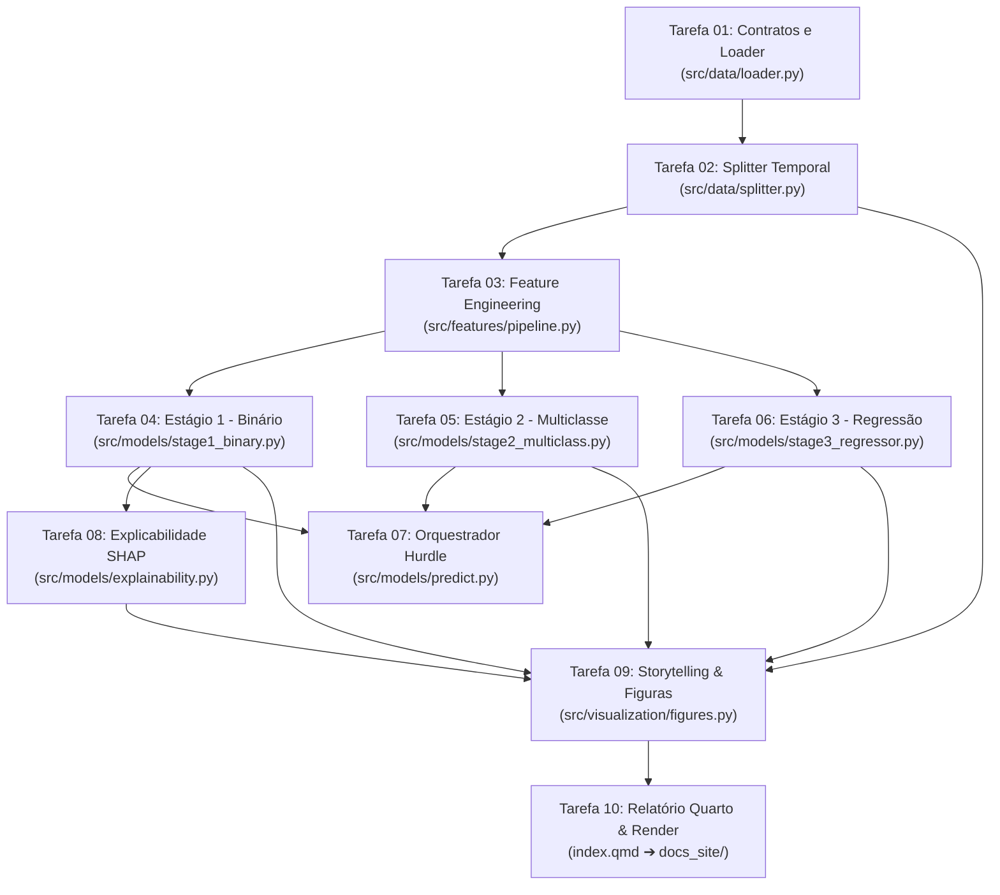

# Plano de Implementação Técnica e Estratégia de Testes (Gate 5)

> **Regra de Execução:** Este plano atômico define a sequência estrita de implementação orientada por testes (TDD). Nenhuma etapa subsequente pode ser iniciada antes que os testes unitários da etapa anterior passem com 100% de sucesso.

- **Objetivo:** Construir, validar e reportar o pipeline analítico de detecção de fraudes em cartão de crédito utilizando a arquitetura Hurdle Model em três estágios, calibragem financeira de corte, explicabilidade SHAP e publicação de relatório executivo em Quarto.
- **Arquitetura:** Ingestão contratualizada ➔ Split temporal out-of-time ➔ Feature engineering com fit restrito ao treino ➔ Estágio 1 (Binário LightGBM/XGBoost + Threshold Custo) ➔ Estágio 2 (Multiclasse LightGBM 4 classes) ➔ Estágio 3 (Regressão Huber em Fraudes) ➔ SHAP TreeExplainer ➔ Geração das 8 figuras ➔ Quarto Render (`docs_site/`).
- **Stack:** Python 3.12+, Pandas, NumPy, Scikit-Learn, LightGBM, XGBoost, SHAP, Matplotlib, Seaborn, Pytest, Ruff e Quarto.

---

## 1. Grafo de Precedência Técnica



---

## 2. Checklist Atômico de Tarefas e Ciclos TDD

### Tarefa 01: Ingestão Segura, Saneamento e Validação de Contratos
- **Arquivos:**
  - Código: `src/data/loader.py`
  - Teste: `tests/data/test_loader.py`
- **Responsabilidades:**
  1. Carregar `credit_card_fraud_detection_2026.csv` com `keep_default_na=False`, assegurando que `browser == 'N/A'` não se converta em `NaN` (ADR 0004).
  2. Ordenar cronologicamente por `transaction_datetime` crescente (sanando a inversão de 28/02).
  3. Descartar as colunas redundantes `transaction_id` e `card_id`.
  4. Validar os contratos de dados estipulados no Gate 1 (100.000 linhas, 41 colunas resultantes, 0 nulos).
- **Ciclo TDD:**
  - *Red:* Criar `tests/data/test_loader.py` com testes para conferência de shape, ausência de nulos na coluna `browser` e ordenação estrita de datetime.
  - *Green:* Implementar `load_clean_data(filepath: str) -> pd.DataFrame` em `src/data/loader.py`.
  - *Comando de Validação:* `pytest tests/data/test_loader.py -v`

---

### Tarefa 02: Particionamento Temporal Out-of-Time
- **Arquivos:**
  - Código: `src/data/splitter.py`
  - Teste: `tests/data/test_splitter.py`
- **Responsabilidades:**
  1. Dividir a base ordenada por máscaras temporais estritas (ADR 0002):
     - Treino: `datetime < '2026-09-01'` (~66.860 linhas).
     - Validação: `'2026-09-01' <= datetime < '2026-11-01'` (~16.905 linhas).
     - Teste Cego: `datetime >= '2026-11-01'` (~16.235 linhas).
  2. Garantir isolamento dos alvos ($X$ separado de $y_{bin}$, $y_{multi}$, $y_{reg}$).
- **Ciclo TDD:**
  - *Red:* Escrever teste em `tests/data/test_splitter.py` verificando limites de data de cada conjunto, integridade de tamanho e ausência de interseção temporal.
  - *Green:* Implementar `time_ordered_split(df: pd.DataFrame)` retornando `DataSplits(X_train, y_train, X_val, y_val, X_test, y_test)`.
  - *Comando de Validação:* `pytest tests/data/test_splitter.py -v`

---

### Tarefa 03: Pipeline de Engenharia de Features
- **Arquivos:**
  - Código: `src/features/pipeline.py`
  - Teste: `tests/features/test_pipeline.py`
- **Responsabilidades:**
  1. Transformações Cíclicas: $\sin(2\pi \cdot \text{hour}/24)$ e $\cos(2\pi \cdot \text{hour}/24)$.
  2. Dinâmica Espacial: velocidade aparente $V_{aparente} = \frac{\text{distance\_from\_last\_tx\_km}}{\text{days\_since\_last\_tx} \cdot 24 + 0,1}$ e flag de salto $>500$ km/h.
  3. Desvio de Gastos: z-score do valor da transação e ratio $amount\_vs\_avg\_ratio \ge 5.0$.
  4. Encoders: OneHotEncoder para categorias nominais baixas e TargetEncoder regularizado (fit exclusivo no Treino) para categorias de alta cardinalidade (`merchant_category`, `merchant_country`, `customer_state`).
- **Ciclo TDD:**
  - *Red:* Escrever teste em `tests/features/test_pipeline.py` validando que `.fit()` no treino e `.transform()` na validação produzem número idêntico de colunas sem valores nulos.
  - *Green:* Implementar `build_feature_pipeline() -> ColumnTransformer` em `src/features/pipeline.py`.
  - *Comando de Validação:* `pytest tests/features/test_pipeline.py -v`

---

### Tarefa 04: Estágio 1 — Classificador Binário e Otimização de Custo
- **Arquivos:**
  - Código: `src/models/stage1_binary.py`
  - Teste: `tests/models/test_stage1_binary.py`
- **Responsabilidades:**
  1. Treinar baselines (Dummy Classifier, Regressão Logística ponderada) e modelos candidatos (LightGBM com `scale_pos_weight`, XGBoost).
  2. Avaliar PR-AUC primário e ROC-AUC secundário na Validação.
  3. Implementar a função de custo financeiro:
     $$C(t) = \sum_{FN} \text{PerdaReal}_i + \sum_{FP} \$3,50$$
  4. Determinar o threshold de probabilidade ótimo $t^*$ que minimiza $C(t)$ na Validação e congelá-lo.
- **Ciclo TDD:**
  - *Red:* Testar que o estimador treinado atinge PR-AUC $\ge 0,75$ na validação e que o threshold ótimo $t^*$ está compreendido no intervalo $(0.05, 0.60)$.
  - *Green:* Implementar `train_stage1_binary(X_train, y_train, X_val, y_val)` retornando o modelo ajustado, métricas e $t^*$.
  - *Comando de Validação:* `pytest tests/models/test_stage1_binary.py -v`

---

### Tarefa 05: Estágio 2 — Classificador Multiclasse de Tipos de Fraude
- **Arquivos:**
  - Código: `src/models/stage2_multiclass.py`
  - Teste: `tests/models/test_stage2_multiclass.py`
- **Responsabilidades:**
  1. Filtrar transações fraudulentas (`is_fraud == 1`) ou treinar classificador com as 4 modalidades de fraude (`Card-Not-Present`, `Account-Takeover`, `Synthetic-Identity`, `Card-Present`).
  2. Aplicar pesos balanceados inversos à frequência de cada classe.
  3. Medir Macro F1-Score e Balanced Accuracy.
- **Ciclo TDD:**
  - *Red:* Testar que o classificador retorna previsões das 4 classes de fraude e obtém Macro F1 $\ge 0,65$ na validação.
  - *Green:* Implementar `train_stage2_multiclass(X_train_fraud, y_train_fraud, X_val_fraud, y_val_fraud)`.
  - *Comando de Validação:* `pytest tests/models/test_stage2_multiclass.py -v`

---

### Tarefa 06: Estágio 3 — Regressor Condicional de Perda Financeira
- **Arquivos:**
  - Código: `src/models/stage3_regressor.py`
  - Teste: `tests/models/test_stage3_regressor.py`
- **Responsabilidades:**
  1. Treinar regressor estritamente sobre fraudes confirmadas do Treino para estimar `fraud_amount_lost`.
  2. Utilizar LightGBM Regressor com função de perda Huber (resistente a outliers na cauda longa) e comparar com baseline Ridge.
  3. Avaliar RMSE e MAE.
- **Ciclo TDD:**
  - *Red:* Testar que as predições de perda são estritamente não-negativas e que o RMSE condicional situa-se entre \$45 e \$75.
  - *Green:* Implementar `train_stage3_regressor(X_train_fraud, y_train_fraud, X_val_fraud, y_val_fraud)`.
  - *Comando de Validação:* `pytest tests/models/test_stage3_regressor.py -v`

---

### Tarefa 07: Orquestrador do Hurdle Model (End-to-End Pipeline)
- **Arquivos:**
  - Código: `src/models/predict.py`
  - Teste: `tests/models/test_predict_pipeline.py`
- **Responsabilidades:**
  1. Unificar os três estágios na classe `FraudDetectionHurdlePipeline`.
  2. Aplicar a lógica condicional desacoplada:
     - Se probabilidade $\ge t^*$: `is_fraud_pred = 1`, subtipo predito pelo Estágio 2 e valor predito pelo Estágio 3.
     - Se probabilidade $< t^*$: `is_fraud_pred = 0`, subtipo `'Legitimate'` e valor `0.0`.
  3. Serializar o pipeline completo em `models/hurdle_pipeline.joblib`.
- **Ciclo TDD:**
  - *Red:* Passar lote de transações cruas de teste e verificar consistência estrita (zero perdas para casos rotulados como legítimos, tipos coerentes).
  - *Green:* Implementar a classe `FraudDetectionHurdlePipeline` e método `predict_transactions()`.
  - *Comando de Validação:* `pytest tests/models/test_predict_pipeline.py -v`

---

### Tarefa 08: Motor de Explicabilidade SHAP
- **Arquivos:**
  - Código: `src/models/explainability.py`
  - Teste: `tests/models/test_explainability.py`
- **Responsabilidades:**
  1. Inicializar `shap.TreeExplainer` sobre o modelo campeão do Estágio 1.
  2. Extrair a matriz de valores SHAP para a amostra de validação/teste.
  3. Exportar tabela com as 15 variáveis mais determinantes pelo ganho médio absoluto.
  4. Extrair casos locais paradigmáticos (verdadeiro positivo e falso positivo).
- **Ciclo TDD:**
  - *Red:* Testar que a soma dos valores SHAP com o valor base recompõe o log-odds do modelo.
  - *Green:* Implementar `compute_shap_explanations(model, X_sample)`.
  - *Comando de Validação:* `pytest tests/models/test_explainability.py -v`

---

### Tarefa 09: Storytelling Visual e Geração das 8 Figuras
- **Arquivos:**
  - Código: `src/visualization/figures.py`
  - Teste: `tests/visualization/test_figures.py`
  - Saída: `reports/figures/fig01_*.png` a `reports/figures/fig08_*.png` (300 DPI)
- **Responsabilidades:**
  1. Gerar e salvar as 8 figuras acordadas no storyboard do PRD:
     - `fig01_hourly_fraud_risk.png` (Horário x Fraude com destaque noturno).
     - `fig02_country_risk_multiplier.png` (Barras horizontais de país com baseline).
     - `fig03_authentication_shield.png` (Comparativo EMV Chip e PIN).
     - `fig04_velocity_amount_anomaly.png` (Painel duplo `1x2` com `set_box_aspect(1)` para velocidade e ticket).
     - `fig05_model_performance_cost.png` (Painel duplo `1x2` com Curva PR e Curva de Custo Total em \$).
     - `fig06_shap_explainability.png` (Beeswarm plot SHAP das top 15 features).
     - `fig07_multiclass_confusion_matrix.png` (Matriz de confusão normalizada).
     - `fig08_fraud_amount_residuals.png` (Dispersão Real vs Previsto e resíduos).
  2. Aplicar `sns.despine()`, grid suave `alpha=0.25` e tipografia consistente.
- **Ciclo TDD:**
  - *Red:* Verificar que as 8 figuras existem no disco em `reports/figures/`, não estão corrompidas e possuem resolução $\ge 300$ DPI.
  - *Green:* Implementar `generate_all_figures()` em `src/visualization/figures.py`.
  - *Comando de Validação:* `pytest tests/visualization/test_figures.py -v`

---

### Tarefa 10: Integração do Relatório Quarto e Publicação
- **Arquivos:**
  - Código: `index.qmd`, `_quarto.yml`
  - Saída: `docs_site/index.html`
- **Responsabilidades:**
  1. Preencher `index.qmd` incorporando tabelas de métricas definitivas e links das 8 figuras salvas em `reports/figures/`.
  2. Checar conformidade com o `quarto-quality-checklist.md` (sem títulos com numeração manual, metadados em português, callout blocks).
  3. Executar compilação com o binário validado:
     ```bash
     /usr/lib/rstudio/resources/app/bin/quarto/bin/quarto render --to html
     ```
  4. Verificar geração do artefato estático em `docs_site/`.
- **Validação:**
  - Conferir a existência e renderização limpa de `docs_site/index.html`.

---

## 3. Comandos Padronizados de Verificação Automatizada

A validação de integridade do pipeline completo é executada através de comandos determinísticos:

```bash
# 1. Verificação de estilo e sintaxe (Linter)
ruff check src tests

# 2. Execução da suíte completa de testes unitários e de integração
pytest tests/ -v --durations=10

# 3. Compilação estática do relatório executivo Quarto
/usr/lib/rstudio/resources/app/bin/quarto/bin/quarto render index.qmd --output-dir docs_site
```

---

## 4. Critério de Parada e Liberação para Código

Este plano encerra o ciclo de concepção pré-código (Gates 1 a 5).
Nenhum código de aplicação ou treinamento foi escrito até este ponto.
A aprovação formal deste artefato autoriza o início da execução física das tarefas na Fase 1 (Ingestão e Contratos).
