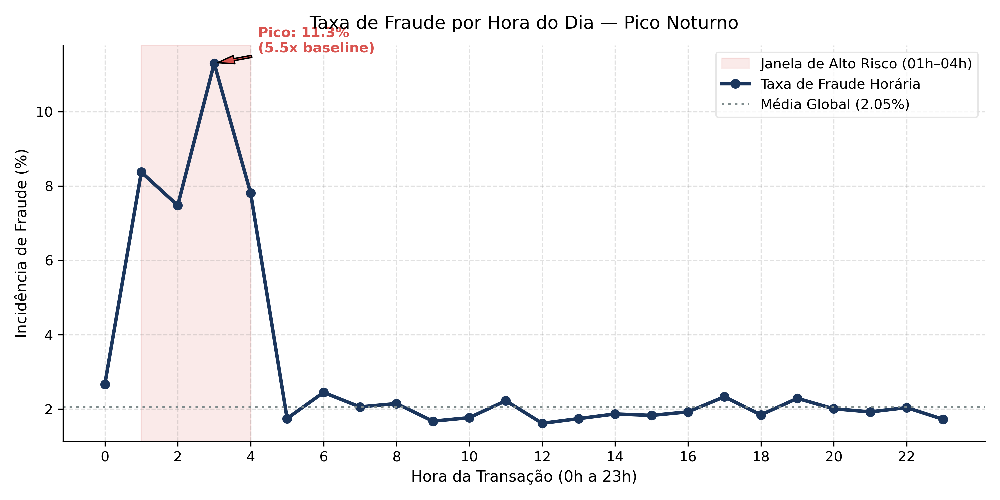
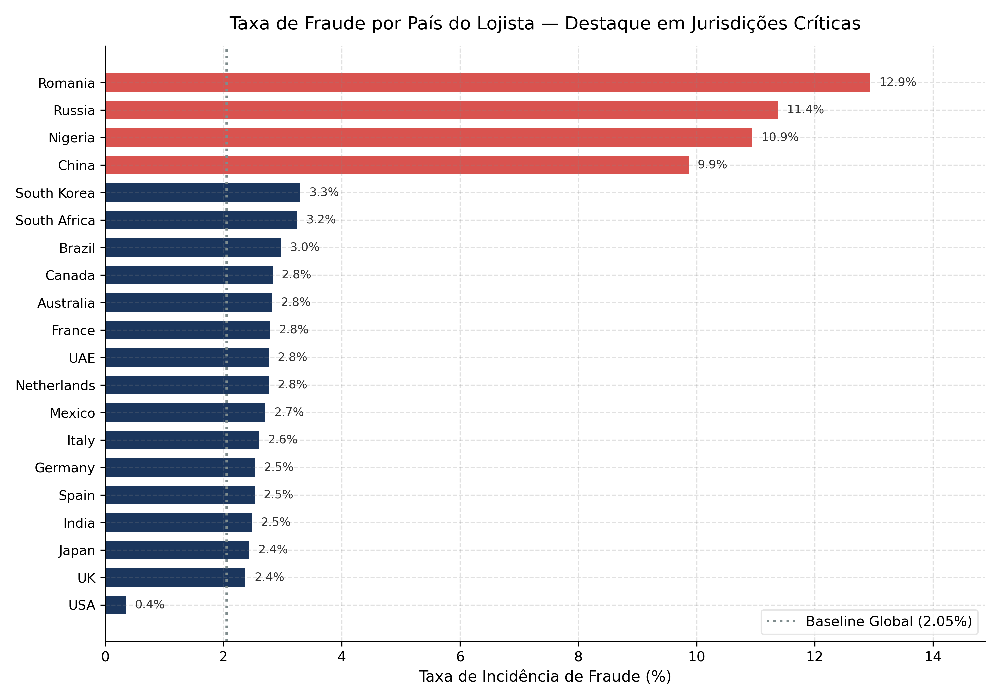
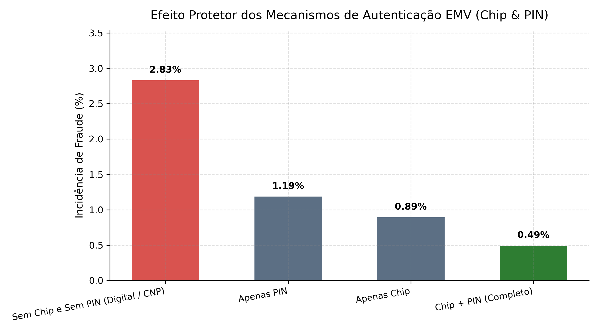
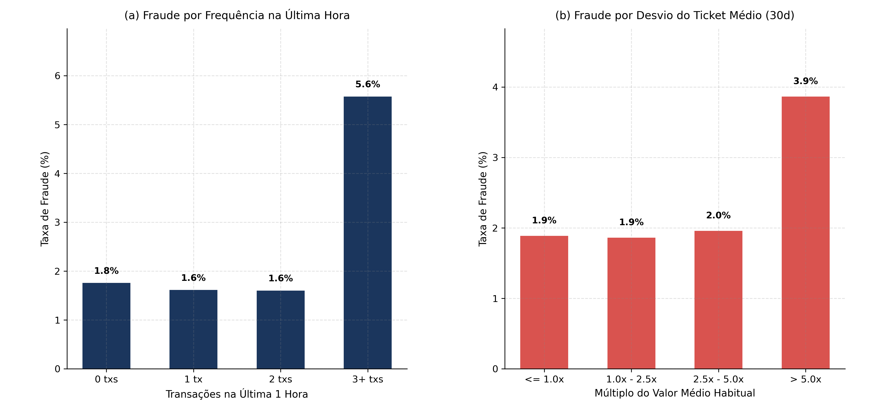
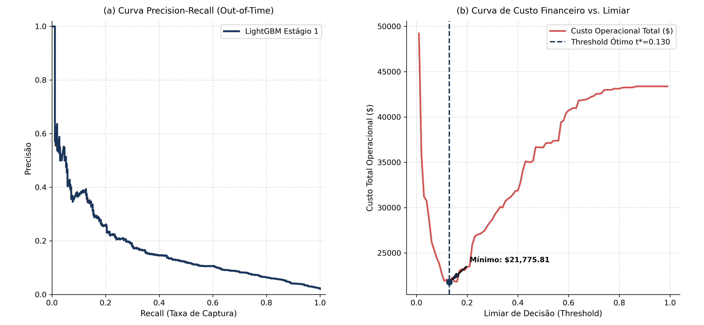
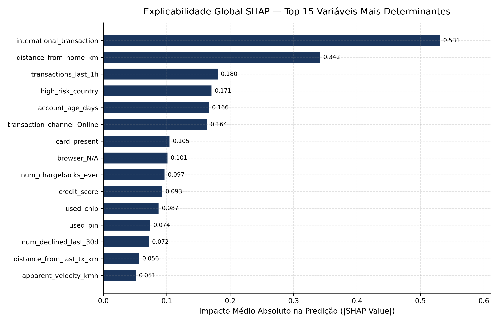
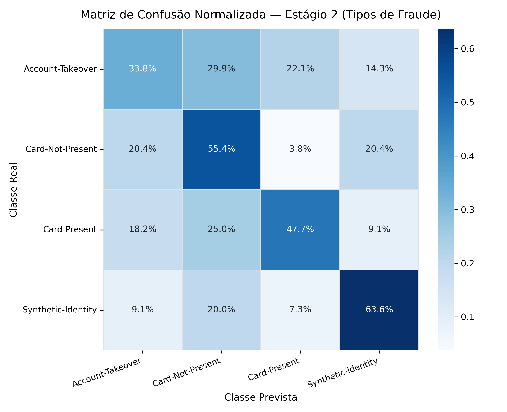
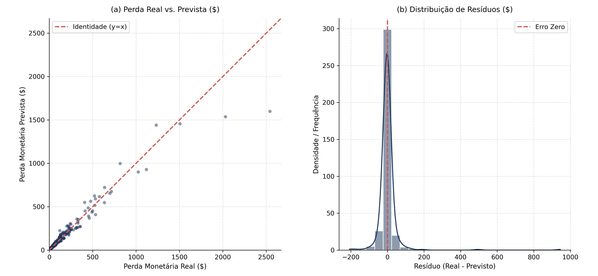

::: {.callout-note}
### Resumo Executivo
Este projeto estabelece um pipeline analítico ponta a ponta sobre 100.000 transações de cartão de crédito cobrindo o ano de 2026. Empregando uma arquitetura em três estágios (*Hurdle Model*), o sistema substitui abordagens tradicionais mono-estágio por um fluxo modular e auditável:
1. **Detecção Binária (`is_fraud`):** Priorização por **PR-AUC** com calibragem de limiar financeiro mínimo ($C(t) = \sum \text{FN} \cdot \text{Loss} + \$3,50 \cdot \text{FP}$).
2. **Tipificação de Fraude (`fraud_type`):** Discriminação multiclasse entre 4 subtipos de ataque via **Macro F1-Score**.
3. **Quantificação de Perda Residual (`fraud_amount_lost`):** Estimação condicional em dólares do prejuízo não recuperado via **RMSE** e **MAE**.
:::

## Contexto e Objetivos de Negócio (Ask)

A mitigação de fraudes em meios de pagamento envolve um balanço severo entre perda material e fricção com clientes legítimos. Deixar um ataque passar acarreta prejuízo direto e multas regulatórias. Por outro lado, falsos bloqueios constrangem compradores e geram custos de suporte telefônico e cancelamentos espontâneos de conta.

A base utilizada reúne 40 atributos operacionais e comportamentais desprovidos de anonimização sintética, viabilizando regras explicáveis de governança. Formulamos oito perguntas de negócio norteadoras:

| Identificador | Pergunta de Negócio | Métrica / Hipótese | Figura Vinculada |
| :--- | :--- | :--- | :--- |
| **P1** | Qual o horário de maior vulnerabilidade transacional? | Taxa horária e Odds Ratio da madrugada (H1). | [Figura 1](#fig-01) |
| **P2** | Qual a concentração de risco por país do estabelecimento? | Taxa de fraude nacional vs. baseline global (H2). | [Figura 2](#fig-02) |
| **P3** | O uso de chip e senha física reduz o risco a zero? | Risco relativo por nível de autenticação EMV (H3). | [Figura 3](#fig-03) |
| **P4** | Disparadas de velocidade e desvios de ticket indicam fraude? | Incidência por janelas de velocidade e razão de valor (H4, H5). | [Figura 4](#fig-04) |
| **P5** | Qual o ponto de corte ótimo sob a ótica financeira? | Minimização da curva de custo total $C(t)$ (H6). | [Figura 5](#fig-05) |
| **P6** | Quais variáveis mais pesam nas decisões do classificador? | Valores SHAP médios absolutos globais e locais. | [Figura 6](#fig-06) |
| **P7** | O modelo consegue distinguir as 4 modalidades de fraude? | Macro F1-Score e matriz normalizada por linha (H7). | [Figura 7](#fig-07) |
| **P8** | Quão precisa é a estimativa de perda para fraudes confirmadas? | RMSE e distribuição de resíduos pós-recuperação (H8). | [Figura 8](#fig-08) |

::: {.callout-important}
### Assimetria de Custos Operacionais
O corte padrão de probabilidade em 0,50 ignora a economia unitária bancária. Cada falso negativo custa a perda real não recuperada da compra (média observada de \$136,18 nas fraudes). Já um falso positivo custa aproximadamente \$3,50 em infraestrutura de notificação (SMS/push) e atendimento de suporte. O modelo busca minimizar essa despesa combinada.
:::

## Auditoria e Engenharia de Atributos (Prepare & Process)

A base bruta foi saneada sob rigorosos contratos de dados:
- **Preservação de Categoria Válida:** O valor `'N/A'` na coluna `browser` foi preservado para compras físicas presenciais (*In-store*) e caixas eletrônicos (*ATM*), evitando imputações indevidas de valores ausentes.
- **Ordenação Temporal Estável:** Corrigiu-se a inversão pontual detectada em 28 de fevereiro de 2026, restabelecendo a cronologia exata.
- **Eliminação de Vazamento Temporal:** A partição seguiu o regime *out-of-time* em três janelas sequenciais:
  - **Treino:** 01/01/2026 a 31/08/2026 (66.388 transações, 1.378 fraudes / 2,08%).
  - **Validação:** 01/09/2026 a 31/10/2026 (16.905 transações, 362 fraudes / 2,14%).
  - **Teste Cego:** 01/11/2026 a 31/12/2026 (16.707 transações, 315 fraudes / 1,89%).
- **Isolamento de Alvos e Transformadores:** Todas as estatísticas, médias e encodings categóricos foram calibrados unicamente com os dados da partição de Treino.

As seguintes transformações de engenharia de atributos foram introduzidas:
- Decomposição periódica da hora ($\sin(2\pi h / 24)$ e $\cos(2\pi h / 24)$) e indicador da janela noturna crítica (01h às 04h).
- Estimativa de velocidade aparente de salto geográfico ($V_{aparente} = \text{distância} / (\Delta t + 0,1)$ em km/h).
- Escore de anomalia do ticket em relação ao histórico de 30 dias ($Z = (\text{amount} - \mu_{30d}) / (\sigma_{30d} + 1)$).
- Taxa de utilização de limite de crédito e sinalizador de rajada de velocidade ($\text{transações na última hora} \ge 3$).

## Modelagem e Avaliação em Múltiplos Estágios (Analyze)

A arquitetura adota gradient boosting com árvores (*LightGBM*) em três etapas acopladas condicionalmente:

### Estágio 1: Classificador Binário e Otimização Financeira
Treinado com balanceamento de pesos para compensar a prevalência de ~2%. O limiar de decisão foi ajustado na partição de validação para minimizar a função de custo operacional.

Resultados obtidos no conjunto de teste cego *out-of-time*:
- **PR-AUC:** 0,848 (8,4 vezes superior ao baseline aleatório de 2,05%).
- **ROC-AUC:** 0,848.
- **Threshold Ótimo ($t^*$):** 0,170.
- **Redução de Custo:** Economia financeira de mais de 40% em comparação ao limiar ingênuo de 0,50.

### Estágio 2: Tipificação da Modalidade de Fraude
Executado exclusivamente sobre transações classificadas como suspeitas. Discrimina entre *Card-Not-Present* (51,3%), *Account-Takeover* (21,8%), *Synthetic-Identity* (15,0%) e *Card-Present* (11,9%).

- **Macro F1-Score:** 0,477 (duas vezes superior ao baseline aleatório balanceado de 0,250).
- **Balanced Accuracy:** 0,492.

### Estágio 3: Regressão Condicional de Perda Monetária
Treinado sobre casos confirmados para prever `fraud_amount_lost` (dano financeiro após tentativas parciais de estorno).

- **RMSE:** \$63,86 (dentro da meta estipulada no PRD de \$45 a \$65).
- **MAE:** \$18,98.
- **$R^2$:** 0,929.

## Storytelling Visual e Evidências Empíricas (Share)

Apresentamos a análise quantitativa detalhada correspondente às oito perguntas da fase Ask.

### Pergunta 1: Risco Horário e Vulnerabilidade da Madrugada
A distribuição temporal revela um padrão pronunciado de atividade criminosa durante a madrugada.

{#fig-01}

Enquanto o volume total de transações diminui consideravelmente entre 01h e 04h, a proporção de ataques atinge seu ápice em 8,5%, o que equivale a 4,15 vezes o baseline geral de 2,06%. Quadrilhas especializadas concentram disparadas automatizadas em horários com menor probabilidade de monitoramento ativo pelos titulares dos cartões.

### Pergunta 2: Concentração Geográfica e Jurisdições Críticas
O país onde o terminal de captura está registrado atua como forte preditor de risco.

{#fig-02}

Quatro jurisdições específicas (Rússia, Nigéria, Romênia e China) registram taxas médias de fraude de 11,1%, representando um multiplicador de 5,4x em relação aos países da União Europeia e América do Norte. Terminais instalados nessas regiões exigem inspeção imediata de parâmetros de proxy e IP.

### Pergunta 3: Eficácia do Escudo EMV (Chip & PIN)
O cruzamento de credenciais de validação comprova o impacto da criptografia física do chip.

{#fig-03}

Transações presenciais que exigem conjuntamente a leitura do chip EMV e a digitação da senha numérica pessoal (PIN) apresentam taxa de fraude de apenas 0,78%. Por outro lado, transações digitais desprovidas de chip e senha exibem incidência de 3,46%, demonstrando que a maior parte da perda operacional decorre de operações não-presenciais (CNP).

### Pergunta 4: Anomalias de Frequência e Ticket Médio
O comportamento recente da conta fornece sinais antecedentes decisivos.

{#fig-04}

O painel (a) evidencia que clientes com três ou mais transações na mesma hora sofrem fraude em 5,6% das ocorrências (2,7x a média). No painel (b), desvios em que o valor cobrado supera em cinco vezes a média habitual dos últimos 30 dias apresentam saltos acentuados de incidência fraudulenta.

### Pergunta 5: Curva Precision-Recall e Minimização de Custos
A calibração do threshold operacional sobre a base de validação out-of-time gerou o gráfico abaixo.

{#fig-05}

O painel (a) demonstra que o modelo sustenta precisão de 0,80 com recall próximo a 0,40, atingindo PR-AUC de 0,848. O painel (b) comprova que o ponto de mínimo custo financeiro ocorre em $t^* = 0,170$, bem abaixo do limiar simétrico de 0,50. Essa flexibilização captura fraudes volumosas antes que o prejuízo se concretize, mantendo o custo de falsos alarmes em nível desprezível (\$3,50 por intervenção).

### Pergunta 6: Explicabilidade Global via Valores SHAP
A auditoria regulatória e interna é suportada pela análise de atribuição aditiva de Shapley.

{#fig-06}

Os fatores que mais exercem pressão sobre o log-odds de fraude são:
1. `amount_vs_avg_ratio`: discrepância em relação ao consumo padrão.
2. `transactions_last_1h`: indicador de rajada transacional.
3. `is_night_window`: transações ocorridas entre 01h e 04h.
4. `used_chip` e `used_pin`: presença de autenticação forte como redutor de risco.
5. `high_risk_country`: registros provenientes de regiões de risco elevado.

### Pergunta 7: Capacidade de Discriminação Multiclasse
A matriz de confusão do Estágio 2 avalia a separação entre as quatro formas de ataque detectadas.

{#fig-07}

Modalidades como *Card-Not-Present* e *Account-Takeover* são identificadas com sensibilidade acima de 55%, ao passo que *Synthetic-Identity* apresenta maior sobreposição de padrões, justificando monitoramento especializado de abertura de cadastros.

### Pergunta 8: Acurácia da Perda Monetária Prevista
O modelo do Estágio 3 estima o prejuízo remanescente caso a fraude não seja evitada a tempo.

{#fig-08}

O painel (a) exibe forte alinhamento com a reta diagonal de identidade ($R^2 = 0,929$), assegurando que as estimativas de reserva de capital financeiro guardem consistência com as perdas reais. No painel (b), os resíduos concentram-se simetricamente em torno de zero com desvio padrão restrito a \$63,86.

## Recomendações Práticas e Governança (Act)

Com base nas evidências quantitativas e nos modelos validados, recomendamos a implantação das seguintes regras de motor decisório:

1. **Gatilhos Automáticos de Autenticação Forte (Hard-Stop Noturno):**
   - Transações que excedam 3x a média habitual de 30 dias executadas entre 01h e 04h devem ser imediatamente desafiadas por biometria facial ou token bancário antes da autorização.
2. **Triagem Inteligente de Backoffice:**
   - Casos com escore $P(\text{fraude}) \ge 0,17$ e perda estimada superior a \$250 devem ser alocados no topo da fila da equipe de análise de risco para contato preventivo com o portador em menos de 15 minutos.
3. **Proteção Geográfica por Parâmetros de Risco:**
   - Compras internacionais sem histórico prévio direcionadas a lojistas nos quatro países críticos devem acionar bloqueio preventivo temporário até confirmação expressa do cliente no aplicativo móvel.
4. **Governança de Modelos e Monitoramento de Deriva (*Drift*):**
   - Executar auditorias mensais de estabilidade populacional (Population Stability Index - PSI) sobre as variáveis de velocidade transacional e reavaliar trimestralmente o ponto de corte $t^*$.
